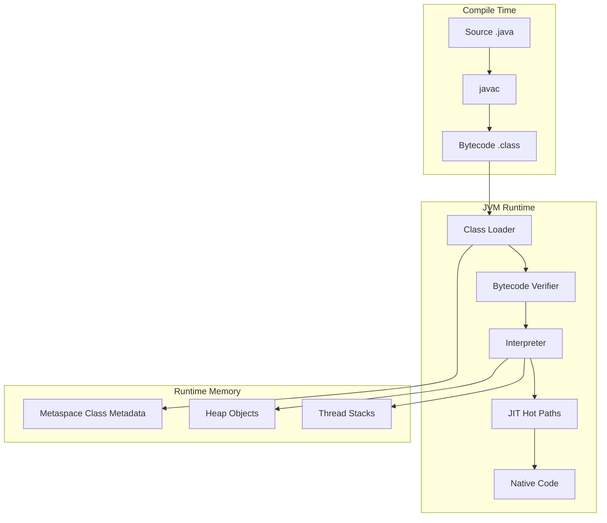

# 01 — Java Fundamentals

## Introduction

Senior interviews rarely ask “what is a variable?” They probe whether you understand **identity vs equality**, **memory layout**, **immutability**, and how these choices show up as bugs in production HashMaps, caches, and concurrent code. This chapter rebuilds the foundation at Principal depth.

## Definition

**Java fundamentals** are the language and runtime rules that every higher abstraction sits on: types (primitive vs reference), object lifecycle, equality contracts, immutability, keywords that affect visibility/serialization (`final`, `static`, `volatile`, `transient`), and how values move across method calls (pass-by-value).

## Internal Working



### Stack vs heap (simplified)

| Location | Holds | Lifetime |
|----------|-------|----------|
| Stack | Frames, locals (primitives + references) | Method scope |
| Heap | Objects, arrays | Until unreachable + GC |
| Metaspace | Class metadata | Until class unload |

### Pass-by-value

Java always copies the parameter. For objects, the copied value is the **reference**. Rebinding the parameter does not change the caller’s reference; mutating the object does.

```
Caller: ref ──► [Person]
Callee: copy of ref ──► same [Person]
```

### Integer cache / String pool

- `Integer` values in a JVM-defined range (typically −128..127) may be **interned**; `==` can lie.
- String literals are interned in the string pool; `new String("a")` is a distinct object unless interned.

## Why it exists

These rules exist so the language can be:

- **Predictable** for the JVM (types, verification, GC roots)
- **Safe** relative to raw memory languages (no dangling pointers in managed heap)
- **Portable** across OS/CPU via bytecode + JVM

Without a clear equality/immutability model, collections and concurrency collapse into Heisenbugs.

## Advantages

- Strong static typing catches many errors early
- Managed memory removes most use-after-free classes of bugs
- Clear object model enables rich standard libraries and frameworks
- Immutability + value semantics (records) simplify concurrent reasoning

## Disadvantages

- Boxing/unboxing and object headers add memory/CPU cost vs C/Rust
- Subtle contracts (`equals`/`hashCode`, `==` on wrappers) trip even seniors
- “Safe by default” can hide cost until scale (allocation pressure, GC)

## Time Complexity

Not a data-structure chapter — but hot-path costs matter:

| Operation | Typical cost | Notes |
|-----------|--------------|-------|
| Primitive arithmetic | O(1) CPU | Cheap |
| Autoboxing | Allocation + possible GC | Avoid in tight loops |
| `String +` in loop | O(n²) allocations | Use `StringBuilder` |
| `equals`/`hashCode` | Depends on fields | Keep cheap for map keys |

## Memory Considerations

- Every object has a **header** (mark word + class pointer; compressed oops on 64-bit when enabled)
- Arrays store length + contiguous elements
- Wrapper objects dwarf primitives (`Integer` ≫ `int`)
- Interned strings save memory but pin objects in the pool
- Defensive copies trade RAM for safety

## Code Examples

### equals / hashCode contract

```java
public final class Money {
    private final long cents;
    private final String currency;

    public Money(long cents, String currency) {
        this.cents = cents;
        this.currency = Objects.requireNonNull(currency);
    }

    @Override
    public boolean equals(Object o) {
        if (this == o) return true;
        if (!(o instanceof Money m)) return false;
        return cents == m.cents && currency.equals(m.currency);
    }

    @Override
    public int hashCode() {
        return Objects.hash(cents, currency);
    }
}
```

### Autoboxing trap

```java
Integer total = null;
int value = total; // NPE — unboxing null
```

### Immutable value + defensive copy

```java
public final class Window {
    private final int[] bounds; // [x,y,w,h]

    public Window(int[] bounds) {
        this.bounds = bounds.clone();
    }

    public int[] bounds() {
        return bounds.clone();
    }
}
```

### Pass-by-value demo

```java
void rebind(List<String> list) {
    list = new ArrayList<>(); // caller unchanged
}
void mutate(List<String> list) {
    list.add("x"); // caller sees mutation
}
```

## Common Interview Questions

**Q: Difference between `==` and `equals`?**  
A: `==` compares identity for references (value for primitives). `equals` is logical equality; default is identity unless overridden.

**Q: Why must `hashCode` be consistent with `equals`?**  
A: Hash-based collections bucket by hash then confirm with `equals`. Breaking the contract loses entries.

**Q: Is Java pass-by-reference?**  
A: No. Pass-by-value; object parameters receive a copy of the reference.

**Q: Why prefer immutability for map keys?**  
A: Mutation after insert changes bucket location conceptually but object stays in old bucket → lost entries.

**Q: What does `volatile` guarantee?**  
A: Visibility and ordering for that field’s reads/writes. Not atomicity for compounds like `i++`.

## Senior Engineer Notes

- Prefer **records** (Java 16+) for pure data carriers with correct equality.
- Treat wrapper identity (`==`) as a code smell in reviews.
- Measure before micro-optimizing boxing; fix allocation hotspots with profilers (JFR).
- Domain equality ≠ database identity — be explicit in entity design.

## Technical Lead Perspective

- Codify equals/hashCode + immutability rules in the team style guide.
- Ban mutable keys and public mutable arrays in APIs.
- Prefer value objects for money, IDs, ranges — reduce primitive obsession.
- Make “autoboxing in hot loops” a review checklist item for latency-critical services.

## Best Practices

1. Override `equals` and `hashCode` together; use the same fields.
2. Prefer immutable keys and DTOs.
3. Use `Objects.equals` / `Objects.hash`; pattern matching `instanceof` (Java 16+).
4. Prefer `StringBuilder` for loops; avoid `StringBuffer` unless you truly need its sync.
5. Use `enum` for finite domains, not `int`/`String` constants.
6. Prefer composition of small immutable types over god objects.

## Common Mistakes

| Mistake | Why it hurts |
|---------|--------------|
| Mutable `hashCode` fields | Corrupt `HashMap`/`HashSet` |
| `==` on `Integer`/`Long` | Cache-dependent bugs |
| Forgetting null-safe equals | NPEs / asymmetric equals |
| Returning internal mutable arrays | Breaks encapsulation |
| Relying on `Cloneable` | Broken contract; prefer copy ctor |
| Assuming `volatile` fixes races | Lost updates on RMW |

## Summary

Fundamentals at senior level are about **contracts and costs**: equality, identity, immutability, and how values live in memory. Master these and collections/concurrency interviews become far easier.

## Cheat Sheet

| Topic | Rule |
|-------|------|
| `==` vs `equals` | Identity vs logic |
| Wrappers | Use `equals`; watch cache |
| Pass-by | Always by value |
| Map keys | Immutable + stable hash |
| Strings | Immutable; builder in loops |
| `volatile` | Visibility ≠ atomicity |
| `final` | Safer publication / design |

## Exercises with Answers

**E1.** Will this print `true`?

```java
Integer a = 200, b = 200;
System.out.println(a == b);
```

**A1.** Typically `false` (outside default cache). Never rely on it.

**E2.** Object used as `HashMap` key; then mutate a field used in `hashCode`. What happens?

**A2.** Lookup may fail; entry appears “lost” though still in the map.

**E3.** Fix this API smell: `public int[] getCoords() { return coords; }`

**A3.** Return `coords.clone()` or an unmodifiable view / record of components.

**E4.** Why is `String` a good candidate for the constant pool?

**A4.** Immutability makes sharing safe; identical literals can share one instance.
