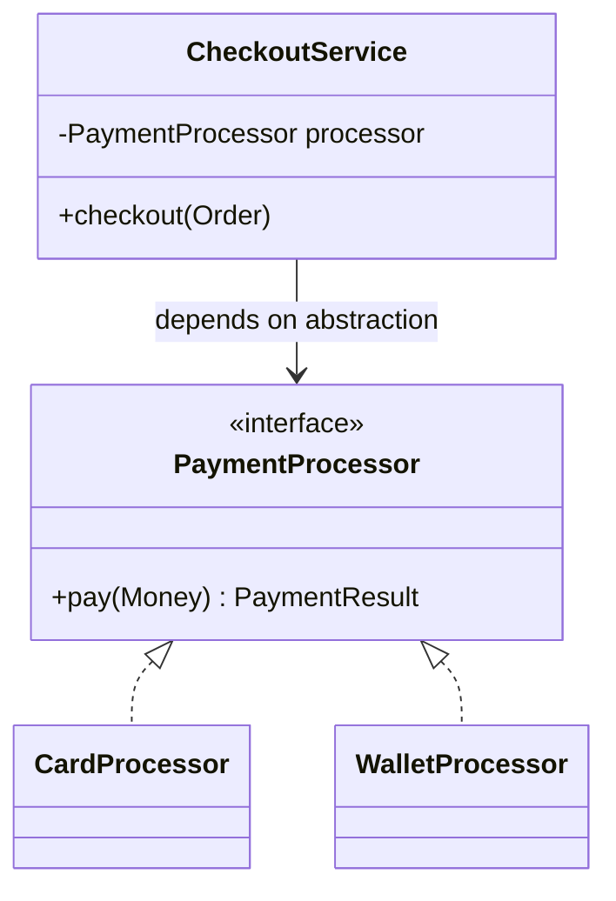

# 02 — OOP (Object-Oriented Programming)

## Introduction

At senior level, OOP is not “classes and inheritance.” It is **modeling**, **boundaries**, and **change management**. Interviewers watch whether you reach for inheritance by habit or design for composition, invariants, and testability.

## Definition

**OOP** organizes software around objects that encapsulate state and behavior. Core pillars: **encapsulation**, **abstraction**, **inheritance**, **polymorphism**. In modern Java practice, **composition**, **interfaces**, and **SOLID** matter more than deep class hierarchies.

## Internal Working

### Polymorphism at runtime

```
Animal a = new Dog();
a.speak();  // invokevirtual / invokeinterface → dispatch to Dog.speak
```

The JVM resolves instance methods via the object’s class (vtable / itable style dispatch). `static`, `private`, and `final` methods use non-virtual binding.



### Encapsulation mechanics

- Access modifiers (`private`, package, `protected`, `public`) shape the API surface
- Invariants live behind methods; fields stay private
- Records give shallow immutability with generated accessors

## Why it exists

OOP exists to manage complexity: hide details, vary behavior behind stable contracts, and let teams evolve modules independently. Inheritance was meant for reuse; industry experience showed **uncontrolled inheritance** creates fragile base classes — hence preference for composition and interfaces.

## Advantages

- Clear domain modeling (entities, value objects, services)
- Polymorphism enables open extension without editing callers
- Encapsulation protects invariants
- Aligns with many enterprise frameworks (Spring DI against interfaces)

## Disadvantages

- Over-engineering with premature abstraction
- Deep inheritance → fragile base class problem
- Anemic domain models (bags of getters) lose OOP’s value
- Virtual dispatch + object allocation can matter in hot paths (usually secondary to design clarity)

## Time Complexity

OOP itself is not algorithmic. Dispatch is O(1). Cost appears when designs cause:

| Design smell | Performance effect |
|--------------|--------------------|
| Excessive allocation of short-lived objects | GC pressure |
| Deep decorator stacks | Call overhead + allocations |
| Reflection-heavy frameworks | Startup / call cost |

Prefer clarity first; optimize measured hotspots.

## Memory Considerations

- Each object instance carries header + fields
- Inheritance stores superclass fields in the same instance layout
- Prefer fewer, cohesive objects over many tiny chatty objects in hot loops
- Flyweight / canonical instances for repeated immutable values

## Code Examples

### Prefer composition

```java
public final class OrderService {
    private final PricingEngine pricing;
    private final InventoryPort inventory;

    public OrderService(PricingEngine pricing, InventoryPort inventory) {
        this.pricing = pricing;
        this.inventory = inventory;
    }

    public Order confirm(Cart cart) {
        inventory.reserve(cart.lines());
        Money total = pricing.price(cart);
        return Order.confirmed(cart, total);
    }
}
```

### Template method vs strategy

```java
// Strategy — usually clearer than deep inheritance
public interface DiscountPolicy {
    Money apply(Money subtotal, Customer customer);
}

public final class Checkout {
    private final DiscountPolicy discount;

    public Money total(Money subtotal, Customer customer) {
        return discount.apply(subtotal, customer);
    }
}
```

### Liskov violation (bad)

```java
class Rectangle {
    void setWidth(int w) { ... }
    void setHeight(int h) { ... }
}
class Square extends Rectangle {
    @Override void setWidth(int w) { setSide(w); }
    @Override void setHeight(int h) { setSide(h); }
}
// Code expecting independent width/height breaks for Square
```

## Common Interview Questions

**Q: Inheritance vs composition?**  
A: Inheritance is an **is-a** coupling (strong). Composition is **has-a** / **uses-a** (flexible). Prefer composition + interfaces unless a true subtype relationship holds (LSP).

**Q: Explain SOLID briefly with Java examples.**  
A: S — one reason to change; O — extend via new implementations; L — subtypes honor contracts; I — small interfaces; D — depend on abstractions (constructor injection).

**Q: Abstract class vs interface?**  
A: Interfaces define capabilities (multiple); abstract classes share state/partial implementation (single extends). Since Java 8, interfaces can have default methods — still prefer interfaces for API contracts.

**Q: What is the fragile base class problem?**  
A: Subclasses break when base class changes protected/internal behavior they implicitly relied on.

**Q: When is inheritance justified?**  
A: True specialization with shared invariant, framework extension points, or sealed hierarchies modeling closed domains (Java 17+).

## Senior Engineer Notes

- Model **behavior boundaries** first (ports/adapters), then classes.
- Use sealed classes/interfaces to document allowed subtypes.
- Prefer package-private implementation classes; export interfaces.
- Distinguish value objects (equality by value) from entities (identity).

## Technical Lead Perspective

- Review PRs for inheritance addiction and god classes.
- Set architecture fitness functions: max inheritance depth, interface segregation.
- Teach juniors: “design for change you can name,” not speculative hierarchies.
- Align domain language with types — ubiquitous language in code reviews.

## Best Practices

1. Program to interfaces; inject dependencies.
2. Keep types small; split when a class has multiple reasons to change.
3. Make illegal states unrepresentable (types > boolean flags).
4. Prefer sealed hierarchies for closed domains.
5. Use records for immutable data carriers; classes for rich behavior.
6. Document LSP expectations for overridable methods.

## Common Mistakes

| Mistake | Fix |
|---------|-----|
| Deep inheritance for reuse | Extract collaborators |
| Public fields / leaking mutability | Encapsulate; immutable where possible |
| God service class | Split by capability |
| Marker inheritance without behavior | Use composition or sealed markers carefully |
| Overusing design patterns by name | Apply pattern for a real force |

## Summary

OOP at senior level is **contract-driven design**: encapsulate invariants, vary behavior via polymorphism, prefer composition, and keep hierarchies shallow and intentional.

## Cheat Sheet

| Concept | One-liner |
|---------|-----------|
| Encapsulation | Hide state; expose behavior |
| Polymorphism | One contract, many implementations |
| Composition | Has-a / uses-a |
| LSP | Subtypes must honor contracts |
| DIP | Depend on abstractions |
| Sealed | Closed world of subtypes |

## Exercises with Answers

**E1.** Refactor: `CsvReport extends PdfReport` only to reuse `formatDate`.  
**A1.** Extract `DateFormatter` collaborator; both reports use it.

**E2.** Is `Stack extends Vector` a good design?  
**A2.** Historically no — exposes Vector methods that break Stack’s contract (LSP smell). Prefer composition.

**E3.** Write an interface-segregated alternative to `Worker { work(); eat(); }` for robots.  
**A3.** `Workable { work(); }` and `Eatable { eat(); }`; humans implement both, robots only `Workable`.
