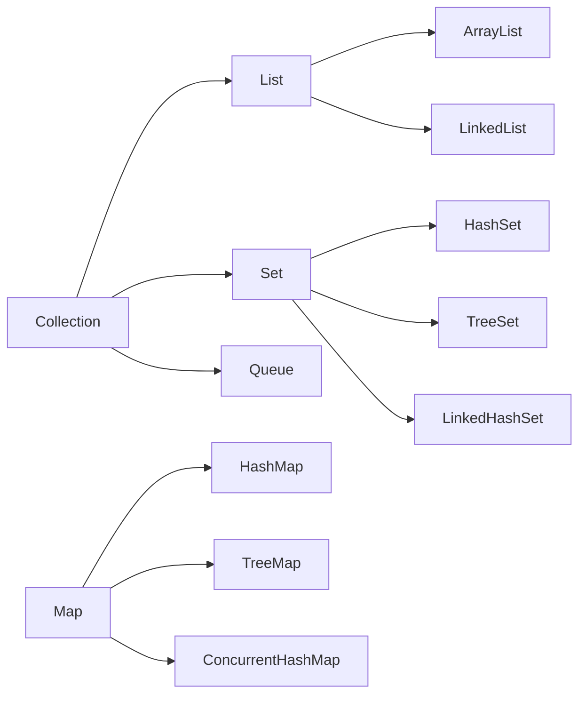

# 03 — Collections Framework

## Introduction

Collections questions separate seniors who “know ArrayList” from those who can pick structures under **latency, memory, concurrency, and ordering** constraints. Expect internals: growth strategy, hash collision handling, `TreeMap` balancing, and concurrent alternatives.

## Definition

The **Java Collections Framework (JCF)** is a unified architecture for representing and manipulating groups of objects: core interfaces (`Collection`, `List`, `Set`, `Map`, `Queue`, `Deque`), implementations, algorithms (`Collections`, `Arrays`), and concurrent variants in `java.util.concurrent`.

## Internal Working



### ArrayList

- Backed by `Object[]`
- Default capacity 10 (implementation detail; don’t rely on it)
- Growth: typically `newCapacity = old + (old >> 1)` (~1.5×)
- Amortized O(1) add at end; O(n) insert/remove in middle (shift)

### LinkedList

- Doubly linked nodes; each node = object header + prev/next/item
- O(1) insert/remove given node; O(n) index access
- Poor cache locality vs `ArrayList`

### HashMap (Java 8+)

```
key → hash → (h ^ (h >>> 16)) → bucket index
bucket: linked list or treeify to red-black tree when bin large (threshold 8, untreeify 6)
```

- Capacity power of two; load factor default 0.75
- Resize doubles capacity; rehash/redistribute
- Null key allowed once (not in concurrent maps)

### TreeMap / TreeSet

- Red-black tree; ordered by `Comparable` or `Comparator`
- Operations O(log n); no null keys (for natural ordering)

### ConcurrentHashMap

- Lock-free / striped concurrency (Java 8+: CAS + synchronized bins)
- Size is estimate under concurrency; aggregate ops carefully
- No null keys/values

## Why it exists

Before JCF, each library invented its own vector/hashtable APIs. A shared vocabulary (`List`, `Map`) enables reusable algorithms, clearer APIs, and predictable performance contracts.

## Advantages

- Standard interfaces → swappable implementations
- Well-documented complexity expectations
- Rich algorithms (sort, binary search, sync wrappers)
- Concurrent collections avoid coarse `Collections.synchronizedMap` in many cases

## Disadvantages

- Easy to pick the wrong structure (`LinkedList` overuse)
- Legacy sync wrappers give false confidence
- Boxing for primitive-heavy workloads (consider specialized libs if proven hot)
- Fail-fast iterators surprise under concurrent modification

## Time Complexity

| Structure | Access | Search | Insert end | Insert mid | Notes |
|-----------|--------|--------|------------|------------|-------|
| ArrayList | O(1) | O(n) | Amortized O(1) | O(n) | Best default list |
| LinkedList | O(n) | O(n) | O(1) | O(1)* | *given node; poor locality |
| HashMap | — | Avg O(1) | Avg O(1) | — | Worst O(n) / tree O(log n) |
| TreeMap | — | O(log n) | O(log n) | — | Sorted |
| HashSet | — | Avg O(1) | Avg O(1) | — | Via HashMap |
| PriorityQueue | peek O(1) | — | O(log n) | — | Heap |
| ConcurrentHashMap | — | Avg O(1) | Avg O(1) | — | Concurrent |

## Memory Considerations

| Structure | Memory notes |
|-----------|--------------|
| ArrayList | Contiguous; wasted capacity until trim |
| LinkedList | High per-element overhead (node objects) |
| HashMap | Table + nodes/trees; load factor trades memory vs collisions |
| TreeMap | Per-entry node with parent/left/right/color |
| EnumSet/EnumMap | Bit-vector / array — extremely compact |

## Code Examples

### Choose structure by need

```java
List<String> randomAccess = new ArrayList<>();
Deque<String> stackOrQueue = new ArrayDeque<>(); // prefer over Stack/LinkedList
Map<String, User> byId = new HashMap<>();
Map<String, User> insertionOrder = new LinkedHashMap<>();
Map<String, User> sorted = new TreeMap<>();
Map<String, User> concurrent = new ConcurrentHashMap<>();
```

### Safe iteration snapshot

```java
List<String> copy = List.copyOf(liveList); // immutable snapshot (Java 10+)
for (String s : copy) { ... }
```

### compute / merge (atomic-ish updates on map)

```java
map.merge(userId, 1, Integer::sum);
map.compute(userId, (k, v) -> v == null ? 1 : v + 1);
```

### IdentityHashMap / EnumMap

```java
Map<Status, Integer> counts = new EnumMap<>(Status.class);
Map<Object, String> identity = new IdentityHashMap<>(); // == not equals
```

## Common Interview Questions

**Q: ArrayList vs LinkedList?**  
A: Prefer ArrayList for almost all cases (locality, random access). LinkedList rarely wins; `ArrayDeque` for queue/stack.

**Q: How does HashMap handle collisions?**  
A: Chain in bucket; treeify to red-black tree when bin exceeds threshold (Java 8+).

**Q: HashMap vs ConcurrentHashMap?**  
A: CHM allows concurrent readers/writers without locking the whole map; disallows nulls; sizing/iteration semantics differ.

**Q: Why override equals and hashCode for HashMap keys?**  
A: Bucketing + equality check; broken contract loses entries.

**Q: Fail-fast vs weakly consistent iterators?**  
A: ArrayList iterators fail-fast on structural mod; CHM iterators are weakly consistent (may reflect some post-creation updates).

**Q: LinkedHashMap use cases?**  
A: Insertion-order iteration; access-order for LRU caches (`removeEldestEntry`).

## Senior Engineer Notes

- Default to `ArrayList`, `HashMap`, `ArrayDeque`, `HashSet`.
- Measure before introducing concurrent collections — sometimes a single-threaded shard is simpler.
- `Collections.synchronizedList` synchronizes each call but compound actions still need external locking.
- Prefer unmodifiable copies at API boundaries (`List.copyOf`, `Map.copyOf`).

## Technical Lead Perspective

- Ban `LinkedList` unless a comment explains why (and a benchmark).
- Standardize cache implementations (Caffeine) over hand-rolled LinkedHashMap LRU unless constrained.
- Review for accidental O(n²) (`list.contains` in loops, repeated resize patterns).
- Educate on concurrent modification: prefer immutable snapshots or concurrent structures deliberately.

## Best Practices

1. Program to interfaces (`List`, `Map`), construct concrete types at edges.
2. Specify initial capacity when size is known to reduce resize.
3. Use `EnumSet`/`EnumMap` for enum domains.
4. Prefer `ArrayDeque` over `Stack` and often over `LinkedList`.
5. Never mutate a map while iterating unless using iterator.remove / concurrent APIs.
6. For primitives at scale, consider specialized collections only after profiling.

## Common Mistakes

| Mistake | Reality |
|---------|---------|
| Using LinkedList for performance | Usually slower |
| Relying on synchronized wrappers for compounds | Race on check-then-act |
| Using HashMap in multi-writer scenarios | Data races / loops historically |
| Mutable keys | Lost entries |
| Assuming HashMap order | Unspecified (use LinkedHashMap) |
| `map.get(k)` then `put` without concurrency control | Lost updates |

## Summary

Collections mastery is **matching interface + implementation to access pattern, ordering, and concurrency**, with HashMap/ArrayList internals as the baseline every senior must explain.

## Cheat Sheet

| Need | Reach for |
|------|-----------|
| Default list | ArrayList |
| Queue/stack | ArrayDeque |
| Unordered unique | HashSet |
| Sorted unique | TreeSet |
| Fast map | HashMap |
| Insertion order map | LinkedHashMap |
| Concurrent map | ConcurrentHashMap |
| Enum keys | EnumMap |

## Exercises with Answers

**E1.** Implement a simple LRU cache capacity N.  
**A1.** `LinkedHashMap` with `accessOrder=true` and override `removeEldestEntry`.

**E2.** Why can `HashMap.get` be O(log n) in a bucket?  
**A2.** Treeified bin uses red-black tree.

**E3.** Is `ConcurrentHashMap.size()` exact?  
**A3.** May be expensive/approximate under concurrency; don’t use for critical logic.

**E4.** Prefer which for `addFirst`/`addLast` high throughput?  
**A4.** `ArrayDeque` (or concurrent deques if needed).
