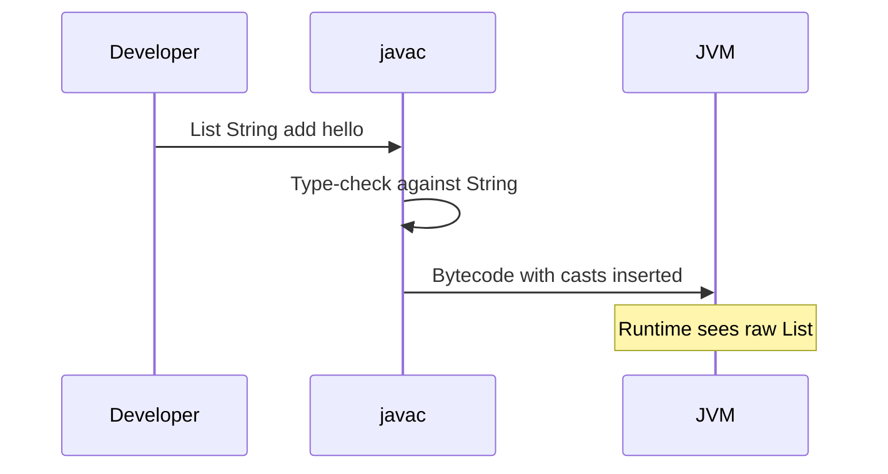

# 04 — Generics

## Introduction

Generics are how Java expresses **type-safe reuse**. Seniors must explain erasure, wildcards (PECS), heap pollution, and how to design APIs that stay safe without forcing casts on callers.

## Definition

**Generics** parameterize types and methods with type variables (`List<T>`, `<T extends Number> T max(...)`) so the compiler can prove type relationships. At runtime, most generic type information is **erased**.

## Internal Working

### Type erasure

```
List<String> → List  (raw) at runtime
T bound → erased to bound (Object if unbounded)
Bridge methods preserve overriding polymorphism
```



### Wildcards

| Form | Meaning | Typical use |
|------|---------|-------------|
| `<?>` | Unknown type | Ignore element type |
| `<? extends T>` | Producer of T | Read T (PECS) |
| `<? super T>` | Consumer of T | Write T (PECS) |

**PECS:** Producer Extends, Consumer Super.

### Reification limits

- Cannot create `new T()`, `new T[]`, check `instanceof List<String>`
- Arrays are reified and covariant → don’t mix with generics carelessly

## Why it exists

Pre-Java 5 collections were raw and cast-heavy → ClassCastExceptions at runtime. Generics move those failures to compile time while remaining backward compatible via erasure (no reified generics on JVM for ordinary classes).

## Advantages

- Compile-time type safety
- Clearer APIs (`Map<UserId, User>` vs raw Map)
- Better IDE assistance and refactoring
- Self-documenting contracts

## Disadvantages

- Erasure prevents some patterns (reified arrays, overloading on generics alone)
- Wildcard complexity (`? super` / `? extends`) confuses teams
- Heap pollution via raw types / unchecked casts
- Verbose signatures on advanced APIs

## Time Complexity

Generics are a compile-time feature. Runtime cost is usually the **same as raw types** plus compiler-inserted casts (negligible). No asymptotic change.

## Memory Considerations

- No per-`T` specialization in the JVM (unlike C++ templates)
- One `ArrayList` class serves all `ArrayList<T>` — memory efficient
- Cannot avoid boxing when using `List<Integer>` vs primitive lists

## Code Examples

### PECS in API design

```java
// Producer — reading from src
public static <T> void copy(List<? extends T> src, List<? super T> dest) {
    for (T item : src) {
        dest.add(item);
    }
}
```

### Bounded type parameters

```java
public static <T extends Comparable<? super T>> T max(Collection<? extends T> items) {
    return items.stream().max(Comparator.naturalOrder()).orElseThrow();
}
```

### Type token for limited reification

```java
public final class JsonParser {
    public <T> T fromJson(String json, Class<T> type) {
        return gson.fromJson(json, type);
    }
}
```

### Safe varargs / @SafeVarargs

```java
@SafeVarargs
public static <T> List<T> listOf(T... elements) {
    return List.of(elements);
}
```

## Common Interview Questions

**Q: What is type erasure?**  
A: Compiler removes most generic type info; runtime has raw types + casts. Enables binary compatibility with pre-generic code.

**Q: Explain PECS.**  
A: Use `? extends` when you only read (producer); `? super` when you only write (consumer); exact `T` when you do both.

**Q: Why can’t you create a generic array `new T[]`?**  
A: Arrays reify component type; generics erase → heap pollution risk. Use `List<T>` or `Array.newInstance` carefully.

**Q: Difference between `List<Object>` and `List<?>`?**  
A: `List<Object>` can add any Object; `List<?>` is a list of unknown type — can read as Object, cannot safely add (except null).

**Q: What is heap pollution?**  
A: Variable of parameterized type refers to an object not of that type (often via raw types/unchecked ops) → later ClassCastException.

## Senior Engineer Notes

- Prefer generic methods over casting in utility classes.
- Capture helpers sometimes needed for complex wildcards.
- Prefer `Class<T>` / `TypeToken` patterns when frameworks need runtime type.
- Avoid raw types entirely in new code.

## Technical Lead Perspective

- Fail CI on raw types (`-Xlint:rawtypes,unchecked` as errors where practical).
- Review public APIs for PECS correctness — this is where library quality shows.
- Document type parameters in Javadoc (`@param <T>`).
- Discourage “star-import wildcards” that hide unsafe casts under `@SuppressWarnings`.

## Best Practices

1. Never use raw types in new code.
2. Apply PECS at API boundaries.
3. Prefer bounded wildcards for flexibility.
4. Minimize `@SuppressWarnings("unchecked")`; isolate and justify.
5. Prefer collections over generic arrays.
6. Use invariant concrete types internally; wildcards at edges.

## Common Mistakes

| Mistake | Problem |
|---------|---------|
| `List<Dog>` treated as `List<Animal>` | Invariance — won’t compile (good!) |
| Using raw `List` | Heap pollution |
| Overusing `?` everywhere | Unreadable; lose write ability |
| Overloading methods that erase to same signature | Won’t compile |
| Expecting `T.class` | Not available — pass `Class<T>` |

## Summary

Generics give **compile-time safety on erased JVM types**. Master erasure limits and PECS to design APIs that are both flexible and safe.

## Cheat Sheet

| Pattern | Use |
|---------|-----|
| `<T>` | Type parameter |
| `<? extends T>` | Read T (producer) |
| `<? super T>` | Write T (consumer) |
| `T extends X` | Upper bound |
| `Class<T>` | Type token |
| Erasure | Runtime ≈ raw |

## Exercises with Answers

**E1.** Why won’t `List<String> ls = new ArrayList<Object>()` compile?  
**A1.** Generics are invariant; would allow storing non-Strings.

**E2.** Fill PECS: method that adds `Integer` into a destination list.  
**A2.** `void addInt(List<? super Integer> dest)`.

**E3.** Why is `instanceof List<String>` illegal?  
**A3.** Erasure — runtime cannot distinguish `List<String>` from `List<Integer>`.

**E4.** Fix: `T[] arr = new T[10];`  
**A4.** Use `List<T>` or `Array.newInstance(clazz, n)` with `Class<T>`.
