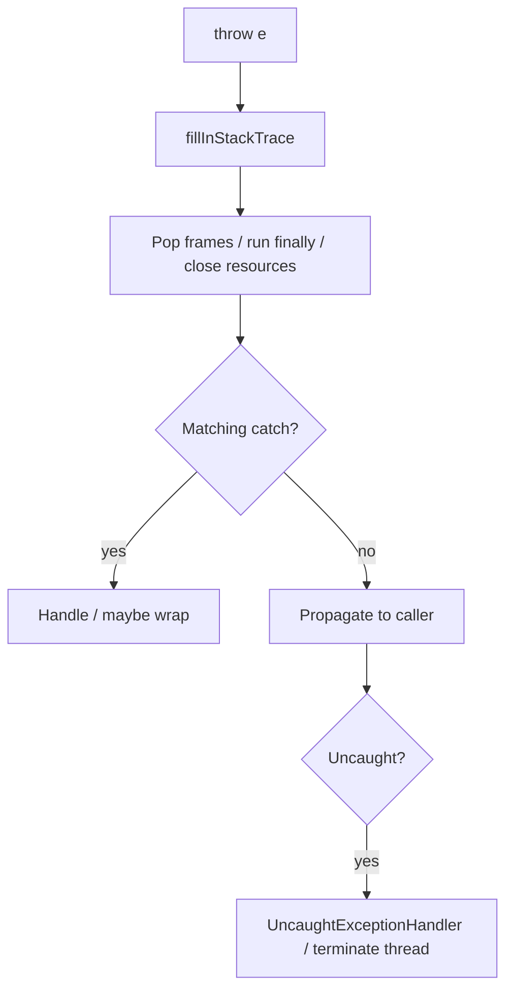

# 05 — Exceptions & Error Handling

## Introduction

Exception design is API design. Seniors are judged on whether failures are **actionable**, resources are **always released**, and control flow isn’t abused. Leads are judged on whether the system fails **loudly, safely, and observably**.

## Definition

An **exception** is an object representing an abnormal condition. Java’s hierarchy:

```
Throwable
├── Error          (serious JVM issues — usually don’t catch)
└── Exception
    ├── RuntimeException  (unchecked)
    └── other Exception   (checked — must declare or handle)
```

## Internal Working



### try-with-resources

Compiler expands to nested `try/finally` calling `close()`, suppressing secondary exceptions via `addSuppressed`.

### Checked vs unchecked (language rule)

- Checked: `Exception` except `RuntimeException` — compile-time enforcement
- Unchecked: `RuntimeException` and `Error` — not required in signatures

## Why it exists

Structured error propagation beats error codes for many APIs: errors can’t be silently ignored as easily (especially checked), stack traces aid diagnosis, and `finally`/try-with-resources ensure cleanup.

## Advantages

- Separates happy path from failure path
- Stack traces accelerate debugging
- try-with-resources prevents resource leaks
- Exception hierarchies model domain failures

## Disadvantages

- Checked exceptions can pollute signatures / encourage bad wrapping
- Exceptions are expensive if used for normal control flow (stack trace fill)
- Swallowing exceptions hides incidents
- Poor wrapping loses root cause (`getCause` chain)

## Time Complexity

| Action | Cost |
|--------|------|
| Creating exception with stack trace | Expensive (stack walk) |
| Throwing/catching rare errors | Acceptable |
| Using exceptions for expected control flow | Anti-pattern — use Optional/Result |

Hot path: prefer conditional checks over throw for expected misses (e.g., cache miss).

## Memory Considerations

- Stack traces retain class/method/line strings — large if thrown often
- Suppressed exceptions add to the chain
- Don’t store exceptions as business state long-term

## Code Examples

### try-with-resources

```java
try (InputStream in = Files.newInputStream(path);
     OutputStream out = Files.newOutputStream(target)) {
    in.transferTo(out);
} catch (IOException e) {
    throw new StorageException("Failed to copy " + path, e);
}
```

### Wrap with cause

```java
catch (SQLException e) {
    throw new OrderRepositoryException("orderId=" + id, e);
}
```

### Multi-catch & precise throws

```java
catch (IOException | SQLException e) {
    log.error("Failed operation", e);
    throw e;
}
```

### Custom domain exception

```java
public final class InsufficientFundsException extends RuntimeException {
    private final Money requested;
    private final Money available;

    public InsufficientFundsException(Money requested, Money available) {
        super("requested=" + requested + ", available=" + available);
        this.requested = requested;
        this.available = available;
    }
}
```

## Common Interview Questions

**Q: Checked vs unchecked — when to use which?**  
A: Unchecked for programming errors and most business rule violations in modern APIs; checked for recoverable conditions the caller **must** confront (controversial — many teams prefer unchecked + Result types). Be ready to argue trade-offs.

**Q: What happens if an exception is thrown in `close()` during try-with-resources?**  
A: If primary exception exists, close exception is **suppressed** and attached; else it propagates.

**Q: Error vs Exception?**  
A: `Error` = serious VM issues (`OutOfMemoryError`); don’t catch unless rethrowing or controlled shutdown.

**Q: Why not use exceptions for control flow?**  
A: Cost + readability; expected outcomes aren’t exceptional.

**Q: How do you preserve stack traces when wrapping?**  
A: Pass the original as `cause` in the constructor.

## Senior Engineer Notes

- Prefer domain exceptions over leaking SQLException/Jackson exceptions across layers.
- Log **once** at the boundary; avoid log-and-rethrow spam.
- For APIs: stable error codes + messages for clients; stack traces internal only.
- Consider `AutoCloseable` for anything with lifecycle.

## Technical Lead Perspective

- Define a team error model: domain exceptions, translation at API edge (Problem Details / error DTO).
- Enforce try-with-resources in reviews; ban empty catch blocks in CI (SpotBugs/Error Prone).
- Incident culture: exceptions must be observable (metrics on error types).
- Decide checked-exception policy explicitly — inconsistency is worse than either choice.

## Best Practices

1. Always wrap with cause when translating layers.
2. Use try-with-resources exclusively for `AutoCloseable`.
3. Catch the most specific type practical; don’t catch `Exception` broadly except at boundaries.
4. Fail fast on violated invariants (`IllegalArgumentException`, `IllegalStateException`).
5. Make messages actionable: include IDs, not PII secrets.
6. Prefer Result/Optional for expected absence.

## Common Mistakes

| Mistake | Fix |
|---------|-----|
| Empty `catch (Exception e) {}` | Handle, wrap, or log+metric |
| `e.printStackTrace()` in prod | Structured logging |
| Losing cause: `throw new X(e.getMessage())` | `new X(msg, e)` |
| Catching Error/Throwable casually | Almost never |
| Declaring `throws Exception` | Narrow types |
| Using exceptions for loop control | Redesign flow |

## Summary

Good exception practice = **clear contracts, preserved causes, guaranteed cleanup, and observable failures**. Treat error handling as part of the public API.

## Cheat Sheet

| Topic | Rule |
|-------|------|
| try-with-resources | Always for closables |
| Wrapping | Keep cause |
| Checked | Compile-enforced recoverability |
| Unchecked | Most domain/runtime failures |
| Error | Don’t catch |
| Control flow | Not for exceptions |

## Exercises with Answers

**E1.** What’s wrong? `catch (Exception e) { throw new RuntimeException(e.getMessage()); }`  
**A1.** Loses stack/cause and type; use `new RuntimeException("ctx", e)`.

**E2.** Two exceptions: primary in `try`, secondary in `close`. How to see both?  
**A2.** `primary.getSuppressed()`.

**E3.** Should `findUser(id)` throw if missing?  
**A3.** Prefer `Optional<User>` or domain `UserNotFoundException` based on whether absence is expected; be consistent.

**E4.** Convert checked IOException at repository boundary.  
**A4.** Catch and wrap in unchecked `StorageException` with cause; document in API.
