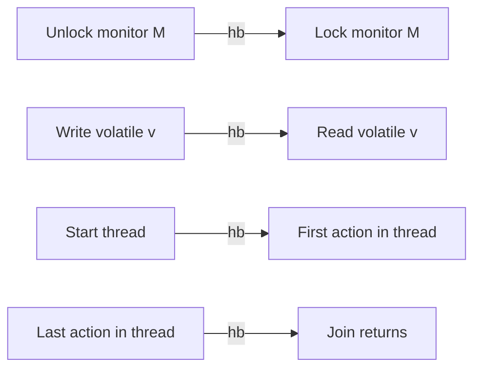

# 06 — Concurrency & Multithreading

## Introduction

Concurrency is the highest-signal Java topic for senior and lead roles. Interviewers want **happens-before**, race diagnosis, executor design, and (on Java 21) **virtual threads** judgment — not just `synchronized` syntax.

## Definition

**Concurrency** is structuring a program so multiple tasks make progress (possibly interleaved). **Parallelism** is executing them simultaneously on multiple cores. Java provides threads, locks, atomics, concurrent collections, the Executor framework, `java.util.concurrent` synchronizers, and virtual threads (Java 21).

## Internal Working

### Java Memory Model (JMM) — happens-before



If action A **happens-before** B, B sees A’s effects. Without hb edges, visibility and ordering are undefined → data races.

### Intrinsic locks

`synchronized` methods/blocks use monitors; entry/exit create hb; mutual exclusion for the same monitor.

### volatile

- Visibility + prevents reordering across the volatile access
- Does **not** make `i++` atomic

### java.util.concurrent overview

| Tool | Role |
|------|------|
| `ExecutorService` | Thread pool abstraction |
| `ReentrantLock` / `ReadWriteLock` | Explicit locking |
| `Semaphore`, `CountDownLatch`, `CyclicBarrier`, `Phaser` | Coordination |
| `Atomic*` / `LongAdder` | Lock-free counters |
| `ConcurrentHashMap`, `CopyOnWriteArrayList`, queues | Concurrent structures |
| `CompletableFuture` | Async composition |
| Virtual threads (21) | Cheap blocking concurrency |

### Thread pools (classic)

```
corePoolSize → queue → maxPoolSize → RejectedExecutionHandler
```

Wrong queue + sizing → latency explosions or OOM.

### Virtual threads (Java 21)

- Lightweight threads scheduled on carrier platform threads
- Ideal for **blocking I/O-bound** workloads
- Avoid pinning (long `synchronized` / native frames) on hot paths
- Don’t pool virtual threads — spawn per task

## Why it exists

Hardware is multi-core; services wait on I/O. Concurrency increases throughput and responsiveness. The JMM exists so the language can define which optimizations are legal without breaking correctly synchronized programs.

## Advantages

- Higher throughput on multi-core and I/O-bound systems
- Explicit synchronizers enable structured coordination
- Concurrent collections reduce coarse locking
- Virtual threads simplify thread-per-request style

## Disadvantages

- Races, deadlocks, livelocks, priority inversion
- Hard to test and reproduce
- Over-threading increases context-switch cost
- Incorrect pool sizing causes cascading failure

## Time Complexity

Concurrency doesn’t change big-O of algorithms, but:

| Concern | Effect |
|---------|--------|
| Lock contention | Throughput collapse (serialization) |
| CAS retries | High under contention — use striping/`LongAdder` |
| Context switches | Latency noise |
| False sharing | Cache-line ping-pong |

## Memory Considerations

- Each platform thread has a large stack (MBs) — limits thread count
- Virtual threads use small continuations — millions feasible
- Escape analysis / allocation still matters under parallel load
- Concurrent structures trade memory for less contention

## Code Examples

### Happens-before via synchronized

```java
private int x;
private final Object lock = new Object();

void writer() {
    synchronized (lock) { x = 42; }
}
int reader() {
    synchronized (lock) { return x; } // sees 42 if after unlock hb lock
}
```

### ExecutorService

```java
try (ExecutorService pool = Executors.newFixedThreadPool(8)) {
    Future<Result> f = pool.submit(this::load);
    return f.get(2, TimeUnit.SECONDS);
}
```

### CompletableFuture composition

```java
CompletableFuture<User> user = supplyAsync(() -> repo.find(id), pool);
CompletableFuture<Prefs> prefs = supplyAsync(() -> prefsClient.get(id), pool);
return user.thenCombine(prefs, this::merge).orTimeout(1, TimeUnit.SECONDS).join();
```

### Virtual threads (Java 21)

```java
try (var executor = Executors.newVirtualThreadPerTaskExecutor()) {
    List<Future<String>> futures = ids.stream()
        .map(id -> executor.submit(() -> client.fetch(id)))
        .toList();
    for (Future<String> f : futures) {
        results.add(f.get());
    }
}
```

### Atomic vs LongAdder

```java
AtomicLong hits = new AtomicLong();
hits.incrementAndGet();

LongAdder hits2 = new LongAdder(); // better under high contention
hits2.increment();
long sum = hits2.sum();
```

## Common Interview Questions

**Q: synchronized vs ReentrantLock?**  
A: Same mutual exclusion basics; `ReentrantLock` adds tryLock, timeouts, fairness option, multiple conditions. Prefer synchronized when sufficient.

**Q: What is a data race?**  
A: Conflicting accesses (at least one write) to same location without hb ordering.

**Q: How do you avoid deadlock?**  
A: Lock ordering, tryLock with backoff, reduce lock scope, prefer lock-free/concurrent structures, detect with jstack/JFR.

**Q: Callable vs Runnable?**  
A: Callable returns value and can throw checked exceptions; Future carries result.

**Q: When virtual threads vs reactive?**  
A: VT for blocking-style simplicity; reactive when you need backpressure/streaming orchestration already invested. Don’t rewrite working WebFlux solely for VT without metrics.

**Q: ThreadLocal pitfalls?**  
A: Leaks in pools if not cleared; use carefully; inheritable TL surprises; VT supports TL but prefer scoped values (21+) for new designs.

## Senior Engineer Notes

- Prefer **immutability + confinement** over sharing.
- Keep critical sections tiny; never I/O under locks.
- Always set timeouts on remote `get()` / joins.
- Name threads; propagate correlation IDs via MDC carefully with pools.
- For Java 21: measure pinning; prefer `ReentrantLock` over heavy `synchronized` if pinning shows up.

## Technical Lead Perspective

- Define concurrency standards: pool sizes, rejection policies, timeouts, circuit breakers.
- Make thread dumps / JFR part of incident runbooks.
- Capacity-plan: platform thread pools for CPU-bound; VT for blocking I/O.
- Review for shared mutable state in “simple” singletons.
- Teach juniors: correctness first, then throughput.

## Best Practices

1. Establish happens-before for every shared mutation.
2. Prefer `java.util.concurrent` over home-grown sync.
3. Use `ExecutorService` / structured concurrency (21 preview/final per version) instead of raw `new Thread`.
4. Bound queues; never `LinkedBlockingQueue` unbounded without thought.
5. Cancel and interrupt cooperatively.
6. Test with TLA+-style reasoning or concurrency testing (JCStress) for critical code.

## Common Mistakes

| Mistake | Outcome |
|---------|---------|
| Double-checked locking without volatile | Broken publication |
| Calling alien methods under lock | Deadlock / races |
| Unbounded thread creation | OOM |
| Ignoring InterruptedException | Unresponsive shutdown |
| Sharing mutable objects across threads | Heisenbugs |
| Pooling virtual threads | Anti-pattern |

## Summary

Correct concurrency is about **memory visibility and atomicity**, not just starting threads. Master JMM, executors, concurrent collections, and Java 21 virtual threads with clear workload criteria.

## Cheat Sheet

| Tool | Use |
|------|-----|
| synchronized/Lock | Mutual exclusion |
| volatile | Visibility flag/state publication |
| Atomic*/LongAdder | Counters |
| CHM | Concurrent map |
| ExecutorService | Pools |
| CF | Async graphs |
| VirtualThread | Cheap blocking tasks |
| Happens-before | Correctness foundation |

## Exercises with Answers

**E1.** Is this safe without sync? `if (instance == null) instance = new X();` shared singleton.  
**A1.** No — race + possible partial publication. Use enum holder, static init, or `volatile` + DCL correctly.

**E2.** `volatile int i; i++;` thread-safe?  
**A2.** No — read-modify-write not atomic. Use `AtomicInteger`.

**E3.** Pick model: 10k blocking DB calls.  
**A3.** Virtual thread per task (Java 21) or bounded async pool with careful queueing; don’t create 10k platform threads.

**E4.** Two locks A,B acquired opposite order in two threads. Fix?  
**A4.** Global lock order; or single lock; or lock-free redesign.
