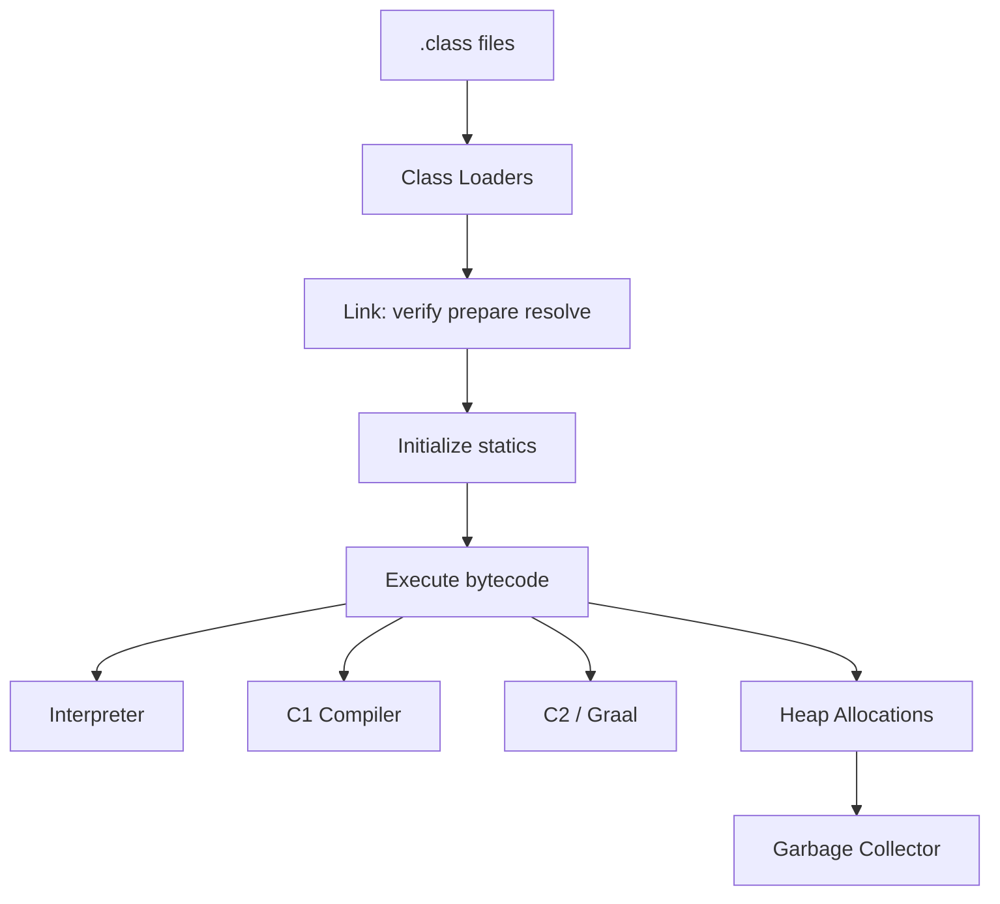

# 07 — JVM Internals

## Introduction

Senior interviews expect you to connect Java code to **runtime behavior**: allocations, GC pauses, classloading, JIT, and tooling. Leads use this knowledge to set SLOs, diagnose incidents, and choose JDK flags responsibly.

## Definition

The **Java Virtual Machine (JVM)** executes bytecode, manages memory (heap/metaspace), loads/links classes, JIT-compiles hot methods, and provides runtime services (threads, JNI, monitoring). “The JVM” usually means a specific implementation (HotSpot) + GC algorithm + configuration.

## Internal Working



### Memory regions (HotSpot conceptual)

| Area | Contents |
|------|----------|
| Heap (Young: Eden + Survivors; Old) | Objects |
| Metaspace | Class metadata |
| Stacks | Per-thread frames |
| Code cache | JIT native code |
| Direct memory | NIO buffers (off-heap) |

### GC overview

| Collector | Trait | Typical use |
|-----------|-------|-------------|
| G1 (default many JDKs) | Balanced throughput/latency | General servers |
| ZGC | Ultra-low pause | Large heaps, latency SLOs |
| Shenandoah | Low pause | Similar goals |
| Parallel | Throughput | Batch |
| Serial | Single thread | Small tools |

### Class loaders

Hierarchy (classic): Bootstrap → Platform → Application → custom. **Delegation** first; child loaders isolate. Class identity = binary name + defining loader.

### JIT

Hot methods compile C1 → C2; speculative optimizations with deoptimization; inlining critical for performance.

## Why it exists

Bytecode + JVM separate language from OS/CPU, enabling portability, safety (verification), managed memory, and adaptive optimization based on real runtime profiles.

## Advantages

- Automatic memory management
- Adaptive JIT can beat static compilers on long-running servers
- Rich observability (JFR, MBeans, thr dumps)
- Portable deployment model

## Disadvantages

- GC pauses / allocation sensitivity
- Warm-up time (JIT) before peak performance
- Opaque performance without tooling literacy
- Misconfigured flags cause outages

## Time Complexity

GC and JIT don’t change algorithm complexity, but dominate wall-clock:

| Symptom | Likely cause |
|---------|--------------|
| High CPU + low alloc | Compute / lock contention |
| Frequent young GC | High allocation rate |
| Long pauses | Old gen / humongous / fragmentation |
| Slow startup | CDS/AOT/Graal native alternatives |

## Memory Considerations

- Object header + alignment → small objects cost more than fields suggest
- Boxing and temporary objects drive young GC
- `byte[]`/`direct ByteBuffer` for large payloads
- Metaspace leaks from repeated dynamic class generation (proxies, scripting)
- Native memory: threads stacks, direct buffers, JNI

## Code Examples

### Allocation awareness

```java
// Bad in hot path: hidden allocations
String id = "" + userId + ":" + ts;

// Better
String id = userId + ":" + ts; // still may allocate
// Or build once / use flyweight keys
```

### JFR programmatically (sketch)

```java
try (Recording r = new Recording()) {
    r.enable("jdk.ObjectAllocationSample");
    r.start();
    work();
    r.stop();
    r.dump(Path.of("alloc.jfr"));
}
```

### Escape analysis friendly

```java
Point p = new Point(x, y); // may scalar-replace if non-escaping
return p.x() + p.y();
```

## Common Interview Questions

**Q: Stack vs heap?**  
A: Stack = frames/locals; heap = objects. References on stack point to heap.

**Q: Explain young vs old generation.**  
A: Most objects die young → collect Eden/Survivors frequently; long-lived objects promote to old; different algorithms/costs.

**Q: What is a STW pause?**  
A: Stop-The-World — application threads halted for some GC phases. ZGC/Shenandoah minimize STW duration.

**Q: Classloader leak?**  
A: Classloader retained by static caches/threads → all classes/metaspace retained after “undeploy.”

**Q: How do you diagnose GC issues?**  
A: GC logs (`-Xlog:gc*`), JFR, heap dump (MAT), allocation sampling, correlate with latency SLIs.

**Q: Compressed oops?**  
A: 32-bit references in heap for heaps under ~32GB (approx) → memory win.

## Senior Engineer Notes

- Optimize **allocation rate** before micro-tuning algorithms.
- Prefer G1/ZGC based on heap size and pause SLOs; measure, don’t cargo-cult flags.
- Use JFR in prod (low overhead) continuously if possible.
- Understand humongous objects in G1 (regions).

## Technical Lead Perspective

- Standardize JDK version + GC + base flags via platform team.
- Require dashboards: heap, GC pause p99, alloc rate, metaspace, threads, safepoints.
- Set heap sizing from load tests, not guesswork (`-Xmx` without history is risk).
- Incident checklist: thread dump, JFR, GC log, heap dump policy (PII!).
- Budget for warm-up in canaries / peak events.

## Best Practices

1. Enable GC logging in production.
2. Right-size heaps; leave headroom for bursts.
3. Avoid finalizers; use `Cleaner`/`AutoCloseable`.
4. Beware unbounded caches — use eviction (Caffeine).
5. Prefer JFR over heavy profilers in prod.
6. Keep JDK updated (LTS); performance and GC improve continuously.

## Common Mistakes

| Mistake | Reality |
|---------|---------|
| `-Xmx` = machine RAM | Native/OS needs room → death spiral |
| Disabling GC flags randomly | Masks symptoms |
| Ignoring metaspace | Native OOM |
| Filling heap dumps into Slack | Security + size disaster |
| Assuming JIT always warm | Short tasks suffer |
| Creating threads per request (platform) | Stack memory explosion |

## Summary

JVM literacy turns “it’s slow” into **measurable hypotheses**: allocation, GC, JIT, classloading, native memory. That skill defines senior backend engineers.

## Cheat Sheet

| Topic | Key idea |
|-------|----------|
| Heap | Objects + GC |
| Metaspace | Class metadata |
| G1/ZGC | Pause vs throughput trade |
| JIT | Hot code → native |
| JFR | Flight recorder diagnostics |
| Classloader | Name + loader identity |
| Warm-up | Don’t bench instantly |

## Exercises with Answers

**E1.** App has frequent short GC pauses and high alloc rate. First move?  
**A1.** Profile allocations (JFR); reduce temporary objects/boxing in hot paths.

**E2.** Latency spikes every few minutes with large heap; G1 mixed GC?  
**A2.** Inspect GC logs for pause causes; consider ZGC if pause SLO tight; check humongous/fragmentation.

**E3.** Redeploying webapp leaks Metaspace. Suspect?  
**A3.** Classloader leak via static caches, ThreadLocals, or running threads holding app classes.

**E4.** Why might a microservice be fast after 10 minutes but slow at start?  
**A4.** JIT warm-up / tiered compilation; consider AOT/CDS or warm-up traffic.
