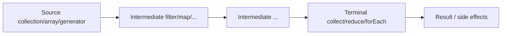

# 08 — Streams & Functional APIs

## Introduction

Streams interviews test whether you write **declarative, correct, and lazy** pipelines — and whether you know when **not** to use streams (or parallel streams). Seniors should explain encounter order, short-circuiting, and collector internals.

## Definition

The **Stream API** (`java.util.stream`) processes sequences of elements through a pipeline of intermediate (lazy) and terminal (eager) operations. It supports sequential and parallel execution over spliterators, integrating with lambdas and method references.

## Internal Working



- **Lazy:** intermediate ops build a plan; nothing runs until terminal
- **Fusing:** multiple ops may combine in one pass
- **Short-circuit:** `findFirst`, `anyMatch`, `limit` can stop early
- **Parallel:** fork-join via `ForkJoinPool.commonPool()` unless custom

### Collectors

`collect` uses `supplier`, `accumulator`, `combiner`, `finisher`. `groupingBy` builds maps; watch concurrent variants for parallel.

## Why it exists

To express bulk data transformations without explicit loops, enabling clearer code and potential parallelism — inspired by functional programming while remaining Java-idiomatic.

## Advantages

- Expressive data transformation
- Laziness avoids unnecessary work
- Easy composition (filter/map/flatMap)
- Parallel option for large CPU-bound workloads (sometimes)

## Disadvantages

- Debugging harder than simple loops
- Easy to hide O(n²) or boxing costs
- Parallel streams often slower / unsafe with shared mutability
- Checked exceptions awkward inside lambdas

## Time Complexity

| Pipeline | Complexity |
|----------|------------|
| Single pass filter+map+collect | O(n) |
| `sorted` | O(n log n) |
| Nested `stream` in `map` without care | Can blow up |
| `distinct` / stateful ops | Extra memory |

Parallelism helps when: large N, pure CPU work, associativity, low contention — **measure**.

## Memory Considerations

- Intermediate boxes for primitives → use `IntStream` etc.
- `collect(toList())` materializes; prefer streaming to sink when huge
- `groupingBy` can build large maps
- Avoid holding references to large streams; streams are one-shot

## Code Examples

### Idiomatic pipeline

```java
Map<Department, Double> avgSalary = employees.stream()
    .filter(Employee::active)
    .collect(Collectors.groupingBy(
        Employee::department,
        Collectors.averagingDouble(Employee::salary)));
```

### flatMap

```java
List<String> tags = posts.stream()
    .flatMap(p -> p.tags().stream())
    .distinct()
    .toList(); // Java 16+
```

### Primitive streams

```java
int sum = IntStream.rangeClosed(1, 100)
    .filter(i -> i % 2 == 0)
    .sum();
```

### Custom collector caution

```java
// Bad: shared mutable list with parallel
List<String> bad = new ArrayList<>();
stream.parallel().forEach(bad::add); // RACE
```

### Optional with streams

```java
return users.stream()
    .filter(u -> u.email().equalsIgnoreCase(email))
    .findFirst();
```

## Common Interview Questions

**Q: Intermediate vs terminal?**  
A: Intermediate lazy and return Stream; terminal triggers execution and closes the stream.

**Q: Are streams reusable?**  
A: No — one terminal consumption.

**Q: map vs flatMap?**  
A: map 1→1; flatMap 1→N flattened.

**Q: When parallelStream?**  
A: Large CPU-bound, associative reductions, no shared mutable state; benchmark. I/O-bound often worse.

**Q: Difference between `Collections.sort` and `stream.sorted`?**  
A: Stream sorted is part of pipeline (can short-circuit with care); may be less clear for in-place list sort — prefer `list.sort` for lists.

**Q: `findFirst` vs `findAny`?**  
A: findFirst respects encounter order; findAny allows less constraint in parallel.

## Senior Engineer Notes

- Prefer readability: if a loop is clearer, use the loop.
- Never mutate external state in parallel pipelines.
- Use collectors over manual reduce for complex aggregates.
- Be careful with short-circuit + side effects.

## Technical Lead Perspective

- Style guide: streams for transformation; loops for complex control/side effects.
- Ban parallelStream in request threads without approval — common pool saturation risk.
- Code review: watch auto-boxing and repeated sorting in hot APIs.
- Encourage `toList()` (unmodifiable) at boundaries (Java 16+).

## Best Practices

1. Keep pipelines pure where possible.
2. Use primitive streams for numeric heavy work.
3. Prefer method references for clarity.
4. Limit parallel to proven gains.
5. Handle nulls before streaming (`filter(Objects::nonNull)`).
6. Don’t use streams just to look “functional.”

## Common Mistakes

| Mistake | Fix |
|---------|-----|
| Side effects in `map` | Use `peek` sparingly / refactor |
| Parallel + ArrayList add | Use concurrent collector / sequential |
| Infinite stream without limit | Always bound |
| `get()` on Optional from find | Handle empty |
| Checked exceptions in lambda | Wrap or extract method |

## Summary

Streams excel at **declarative bulk transforms**. Know laziness, collectors, and the narrow cases where parallel helps — and when a for-loop is the senior choice.

## Cheat Sheet

| Op | Kind | Notes |
|----|------|-------|
| filter/map/flatMap | Intermediate | Lazy |
| distinct/sorted/limit | Intermediate | Stateful / short-circuit |
| collect/reduce | Terminal | Materialize |
| find*/match | Terminal | Short-circuit |
| IntStream | Primitive | Avoid boxing |
| parallel | Mode | Measure; avoid shared mutation |

## Exercises with Answers

**E1.** Convert nested list of lists to flat list of unique items.  
**A1.** `lists.stream().flatMap(List::stream).distinct().toList()`

**E2.** Why is this unsafe? `parallelStream().forEach(list::add)`  
**A2.** `ArrayList` not thread-safe; race.

**E3.** Count words frequency.  
**A3.** `Collectors.groupingBy(w -> w, Collectors.counting())`

**E4.** Infinite primes stream — how to take 10?  
**A4.** Generate + `filter(isPrime).limit(10)`.
