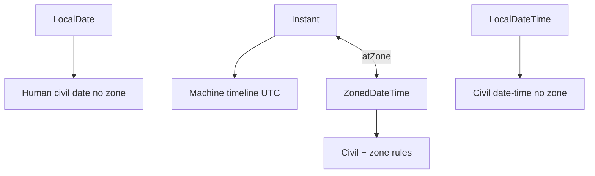

# 09 — Common APIs (String, Optional, Time, IO/NIO)

## Introduction

Day-to-day senior work lives in **String handling**, **Optional discipline**, **java.time**, and **IO/NIO**. Interviews probe misuse: Optional fields, `Date` legacy, blocking IO on event loops, and charset bugs that corrupt data in production.

## Definition

This chapter covers core JDK APIs every senior must wield fluently:

- `String` / `StringBuilder` / text blocks  
- `Optional`  
- `java.time` (JSR-310)  
- IO (`java.io`) and NIO.2 (`java.nio.file`) + channels/buffers basics  

## Internal Working

### String

- Immutable UTF-16 (implementation may use compact Latin-1 byte[] since Java 9)
- Literals interned; `+` compiled to `StringBuilder` in many cases (prefer explicit builders in loops)
- Text blocks (`"""`) preserve formatting (Java 15+)

### Optional

- Explicit presence/absence container for **return types**
- Allocation cost; not free — don’t use as field spam

### java.time



Immutable, zone-rules aware (`ZoneId`), replaces `Date`/`Calendar`.

### NIO.2 Path/Files

- `Path` abstract location; `Files` utilities
- `FileChannel` / `ByteBuffer` for high-performance IO
- Charset encoding must be explicit for correctness

## Why it exists

These APIs solve everyday problems with safer defaults than legacy (`null`, `Date`, platform charset). Optional makes absence visible; java.time fixes DST nightmares; NIO.2 modernizes filesystem access.

## Advantages

- Immutable time types → safer concurrency
- Optional clarifies API contracts
- Text blocks improve readability for SQL/JSON
- NIO.2 richer than `File` (walk, watch, attributes)

## Disadvantages

- Optional can be overused (fields, parameters)
- java.time has a learning curve (`Instant` vs `ZonedDateTime`)
- Mixing legacy `Date` with java.time causes bugs
- Buffers/`Charset` mistakes cause silent corruption

## Time Complexity

| API | Notes |
|-----|-------|
| String concat in loop | O(n²) allocations — use builder |
| `Files.walk` large trees | I/O bound; stream must be closed |
| Regex on hot path | Compile `Pattern` once |
| Optional map chains | Clarity over microcost usually |

## Memory Considerations

- Large `String`s: substrings no longer share backing array (Java 7u6+) — good for leaks, watch copies
- `ByteBuffer.allocateDirect` → off-heap; free carefully / GC-managed but pressure differs
- Don’t cache unbounded file contents in memory

## Code Examples

### StringBuilder & text block

```java
String sql = """
    SELECT id, name
    FROM users
    WHERE active = true
    ORDER BY name
    """;

StringBuilder sb = new StringBuilder(items.size() * 8);
for (String item : items) {
    sb.append(item).append(',');
}
```

### Optional discipline

```java
public Optional<User> findByEmail(String email) { ... }

User user = findByEmail(email)
    .orElseThrow(() -> new UserNotFoundException(email));

// Bad: Optional as field / parameter
```

### java.time

```java
Instant now = Instant.now();
ZonedDateTime tokyo = now.atZone(ZoneId.of("Asia/Tokyo"));
LocalDate due = LocalDate.now(ZoneOffset.UTC).plusDays(7);

// Persist Instant or OffsetDateTime; convert at edges
```

### NIO.2

```java
Path path = Path.of("data", "report.csv");
List<String> lines = Files.readAllLines(path, StandardCharsets.UTF_8);

try (Stream<String> stream = Files.lines(path, StandardCharsets.UTF_8)) {
    return stream.filter(l -> !l.isBlank()).count();
}
```

## Common Interview Questions

**Q: String vs StringBuilder vs StringBuffer?**  
A: String immutable; StringBuilder mutable unsynchronized; StringBuffer synchronized (rarely needed).

**Q: Why not Optional as method parameter?**  
A: Forces allocation/wrapping; use overloading or nullable with clear docs — Optional shines as return type.

**Q: Instant vs ZonedDateTime?**  
A: Instant = UTC timeline point; ZonedDateTime = local civil time with zone rules (DST).

**Q: How do you handle time zones in distributed systems?**  
A: Store UTC (`Instant`); convert to zone at UI/reporting edges; never trust server default zone silently.

**Q: Files vs File?**  
A: Prefer NIO.2 `Path`/`Files` for modern features and clearer errors.

## Senior Engineer Notes

- Always pass `Charset` explicitly (`UTF_8`).
- Ban `new Date()` in new code; use java.time.
- Optional: return type only; never `.get()` without guard.
- Close streams from `Files.lines` / `walk` (try-with-resources).

## Technical Lead Perspective

- Codify time policy: UTC storage, zone at edges.
- Add Error Prone / ArchUnit rules against `Date`/`Calendar` in new modules.
- Review Optional abuse in domain entities.
- Standardize CSV/JSON reading with explicit charsets and size limits (DoS).

## Best Practices

1. Text blocks for multi-line literals.
2. `Locale`/`Charset` explicit for parsing/formatting.
3. Prefer `Path.of`, `Files`, try-with-resources.
4. Use `DateTimeFormatter` (immutable, thread-safe) not `SimpleDateFormat`.
5. Validate string length/content at trust boundaries.
6. Prefer `String.isBlank()` (11+) appropriately.

## Common Mistakes

| Mistake | Fix |
|---------|-----|
| `SimpleDateFormat` static shared | Race — use `DateTimeFormatter` |
| Optional field in entity | Use nullable + docs or empty value type |
| Ignoring charset | UTF-8 explicit |
| `Files.readAllBytes` huge files | Stream / limit |
| Comparing `LocalDateTime` across zones | Use Instant/Zoned |

## Summary

Master the APIs you touch daily: immutable strings/time, disciplined Optional, and correct IO with charsets and resource management.

## Cheat Sheet

| Need | API |
|------|-----|
| Build strings in loops | StringBuilder |
| Multi-line | Text block |
| Absence as return | Optional |
| Timestamp store | Instant |
| User calendar | ZonedDateTime |
| Files | Path + Files |
| Encoding | StandardCharsets.UTF_8 |

## Exercises with Answers

**E1.** Convert `Date` to `Instant`.  
**A1.** `date.toInstant()` (and reverse `Date.from(instant)`).

**E2.** Why is `Optional<String> name` as a JPA field discouraged?  
**A2.** Framework mapping/serialization pain; Optional not serializable design for fields.

**E3.** Fix DST bug: store `LocalDateTime.now()` for event start worldwide.  
**A3.** Store `Instant` or `ZonedDateTime` with explicit zone.

**E4.** Count lines without loading entire file.  
**A4.** `try (Stream<String> s = Files.lines(path)) { return s.count(); }`
