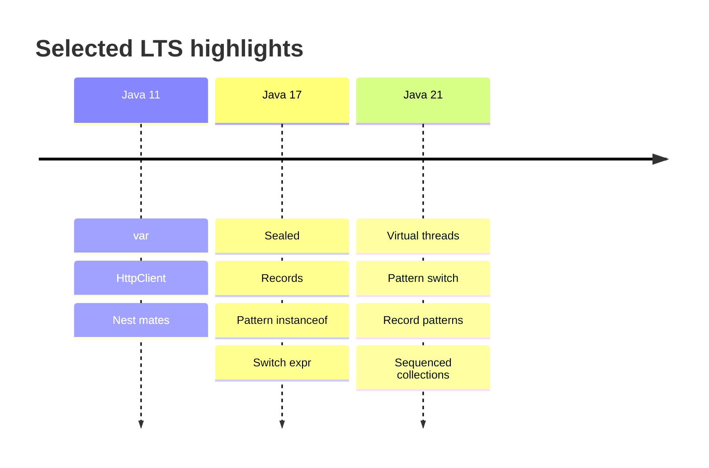

# 10 — Modern Java (17–21 LTS)

## Introduction

FAANG and enterprise interviews increasingly expect **Java 17/21 fluency**: records, sealed types, pattern matching, text blocks, switch expressions, sequenced collections, and **virtual threads**. This chapter is your LTS upgrade brief.

## Definition

**Modern Java** refers to features delivered from Java 9 modularization through **Java 17 LTS** and **Java 21 LTS** that change how we model data, control flow, and concurrency — without abandoning the JVM’s core semantics.

## Internal Working



### Records

- Transparent immutable carriers: final fields, canonical ctor, accessors, equals/hashCode/toString
- Can have compact constructors for validation
- Not a full replacement for rich domain entities with identity

### Sealed classes/interfaces

- Restricts permitted subtypes → enables exhaustive switches
- Documents closed domain hierarchies

### Pattern matching

- `instanceof` patterns; switch patterns (21); record patterns deconstruct

### Virtual threads

- See [06-Concurrency.md](06-Concurrency.md) — mapped to carriers; great for blocking I/O

### Sequenced collections (21)

- `SequencedCollection` / `SequencedSet` / `SequencedMap` — encounter order APIs (`getFirst`, `reversed`)

## Why it exists

Older Java was verbose for data carriers, weak for algebraic data modeling, and awkward for thread-per-request at scale. Modern features reduce boilerplate, enable safer exhaustiveness, and make high-throughput blocking servers practical again.

## Advantages

- Less boilerplate (records)
- Exhaustive modeling (sealed + switch)
- Clearer null/branch logic (patterns)
- Virtual threads simplify concurrency models
- Better APIs (HttpClient, sequenced collections)

## Disadvantages

- Migration cost across large codebases
- Mixed styles (old + new) without team standards
- Virtual thread pinning pitfalls
- Records misused as entities with mutable identity needs

## Time Complexity

Language features are generally O(1) sugar. Impact is **engineering velocity** and sometimes **runtime**:

| Feature | Performance note |
|---------|------------------|
| Records | Same as hand-written immutable class |
| Pattern switch | Comparable to if-else chains |
| Virtual threads | Huge scalability for blocking I/O |
| Reflection on records | Accessors are normal methods |

## Memory Considerations

- Records still objects with headers
- Virtual threads: many lightweight stacks vs platform threads
- Prefer records over multi-field tuples of `Object[]`

## Code Examples

### Record + validation

```java
public record Money(long cents, String currency) {
    public Money {
        if (cents < 0) throw new IllegalArgumentException("cents");
        currency = Objects.requireNonNull(currency);
    }
}
```

### Sealed hierarchy + exhaustive switch (21)

```java
sealed interface Shape permits Circle, Rectangle {}
record Circle(double r) implements Shape {}
record Rectangle(double w, double h) implements Shape {}

static double area(Shape s) {
    return switch (s) {
        case Circle c -> Math.PI * c.r() * c.r();
        case Rectangle r -> r.w() * r.h();
    };
}
```

### Pattern matching instanceof

```java
if (obj instanceof String s && !s.isBlank()) {
    return s.trim();
}
```

### Virtual threads + structured style

```java
try (var scope = Executors.newVirtualThreadPerTaskExecutor()) {
    Future<A> a = scope.submit(this::loadA);
    Future<B> b = scope.submit(this::loadB);
    return combine(a.get(), b.get());
}
```

### SequencedMap (21)

```java
SequencedMap<String, Integer> map = new LinkedHashMap<>();
map.putFirst("a", 1);
map.putLast("z", 26);
String firstKey = map.firstEntry().getKey();
```

### Switch expressions

```java
String label = switch (status) {
    case NEW, OPEN -> "active";
    case CLOSED -> "done";
    case CANCELLED -> "cancelled";
};
```

## Common Interview Questions

**Q: Record vs class?**  
A: Records for immutable data carriers with value equality; classes for identity, mutability, inheritance needs.

**Q: Why sealed types?**  
A: Closed hierarchy → safer refactoring + exhaustive switches; documents allowed implementations.

**Q: Virtual threads vs platform threads?**  
A: VT cheap & plentiful for blocking; platform for CPU-bound pools / carrier foundations.

**Q: What is pinning?**  
A: Virtual thread stuck to carrier (e.g., long `synchronized` / native) → reduces scalability.

**Q: Can records extend other classes?**  
A: No — implicitly extend `Record`; can implement interfaces.

**Q: Pattern matching benefits?**  
A: Less casting boilerplate; enables deconstruction; with sealed types, compiler checks exhaustiveness.

## Senior Engineer Notes

- Adopt records for DTOs/configs/value objects first.
- Prefer sealed interfaces for domain events/commands.
- Migrate off `javax` to `jakarta` in EE/Spring Boot 3 world (often paired with Java 17+).
- Use `var` locally when it improves readability — not for public APIs.

## Technical Lead Perspective

- Set a **language level baseline** (17 or 21) in `pom`/`build.gradle`; don’t leave teams on 8/11 without plan.
- Publish a “Modern Java” style guide: records, sealed, switch, VT criteria.
- Upgrade path: 11 → 17 → 21 with CI + canary; watch removed APIs / security manager changes.
- Train on virtual thread pinning detection (JFR).

## Best Practices

1. Prefer switch expressions over switch statements when returning values.
2. Use text blocks for JSON/SQL templates.
3. Pair sealed types with exhaustive switches — no default if possible.
4. Use virtual threads for blocking I/O fan-out; keep CPU pools platform-based.
5. Prefer `List.of` / `toList` immutable results at boundaries.
6. Keep records shallow; compose rather than mega-records.

## Common Mistakes

| Mistake | Fix |
|---------|-----|
| Mutable record components (mutable lists) | Defensive copy / unmodifiable |
| Using VT for CPU-heavy parallel math | Use FJP / parallel streams carefully |
| `synchronized` heavily with VT | Prefer `ReentrantLock` / reduce lock scope |
| Default branch hiding new sealed subtype | Remove default; fix compile errors |
| Treating record as JPA entity casually | Know provider support/limitations |

## Summary

Java 17–21 modernizes modeling (records/sealed/patterns) and concurrency (virtual threads). Seniors should write idiomatic modern Java; leads should standardize the LTS baseline.

## Cheat Sheet

| Feature | Since | Use |
|---------|-------|-----|
| var | 10 | Local type inference |
| Text blocks | 15 | Multi-line strings |
| Records | 16 | Data carriers |
| Pattern instanceof | 16 | Safer casts |
| Sealed | 17 | Closed hierarchies |
| Switch expr | 14 | Expression switches |
| Virtual threads | 21 | Cheap blocking tasks |
| Pattern switch | 21 | Exhaustive modeling |
| Sequenced collections | 21 | Ordered first/last APIs |

## Exercises with Answers

**E1.** Model success/failure as sealed types instead of exceptions for expected business outcomes.  
**A1.** `sealed interface Result<T> permits Ok, Err` with records; switch exhaustively.

**E2.** Why might VT throughput drop under heavy `synchronized`?  
**A2.** Pinning to carriers reduces scheduling flexibility.

**E3.** Convert a 5-field DTO class to a record with validation.  
**A3.** Use compact constructor checks; keep components immutable.

**E4.** Write exhaustive area switch without default for sealed Shape.  
**A4.** See code example above — compiler enforces cases.
