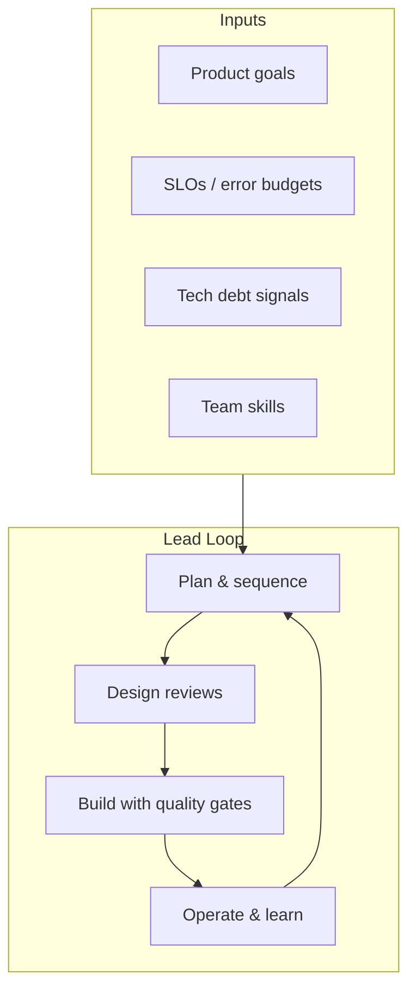

# 12 — Technical Lead Perspective

## Introduction

Tech Lead interviews evaluate **technical judgment under organizational constraints**: delivery, quality, mentoring, incident leadership, and architecture stewardship. You still need deep Java — but answers must include *people, process, and risk*.

## Definition

A **Technical Lead** is accountable for a team’s technical outcomes: system health, design quality, execution predictability, and growing engineers — without necessarily being the people-manager of record (varies by company).

## Internal Working



### Core responsibilities

| Area | Activities |
|------|------------|
| Delivery | Slice work, manage risk, unblock |
| Architecture | Boundaries, ADRs, evolutionary design |
| Quality | Reviews, testing strategy, CI fitness |
| Operations | SLOs, on-call, incident command |
| People | Mentoring, standards, hiring loops |

## Why it exists

As systems and teams grow, someone must align **technical reality** with product goals. Without a lead, quality and operability erode under feature pressure.

## Advantages (of strong TL practice)

- Faster sustainable delivery
- Fewer production surprises
- Clearer ownership
- Engineers grow against a raised bar

## Disadvantages / Failure modes

- Lead as bottleneck (all decisions funnel)
- Ivory-tower architecture
- Hero culture in incidents
- Neglecting IC depth → loss of credibility

## Time Complexity

N/A algorithmically. Use **capacity thinking**:

| Planning lens | Question |
|---------------|----------|
| Throughput | How many meaningful slices per sprint? |
| Risk | What’s the blast radius of this change? |
| Lead time | Idea → production? |
| Load | On-call pages per week? |

## Memory Considerations

Organizational “memory”: ADRs, runbooks, postmortems, onboarding docs. If it only lives in the lead’s head, the team can’t scale.

## Code Examples

Leads encode standards in code/tooling — not slides.

```java
// Example: ArchUnit rule enforcing package boundaries
@AnalyzeClasses(packages = "com.example")
class ArchitectureTest {
    @ArchTest
    static final ArchRule services_dont_depend_on_controllers =
        noClasses().that().resideInAPackage("..service..")
            .should().dependOnClassesThat().resideInAPackage("..web..");
}
```

```text
ADR-0014: Use Outbox pattern for order events
Status: Accepted
Context: Need reliable publish with DB transactions
Decision: Outbox table + poller/CDC
Consequences: Extra storage; operational job; exactly-once via idempotent consumers
```

## Common Interview Questions

**Q: How do you run a design review?**  
**A:** Problem/context → constraints → options with trade-offs → recommendation → risks/rollout → ADR. Invite dissent early; timebox; decide.

**Q: Feature vs reliability conflict?**  
**A:** Error budgets / risk matrix; quantify user impact; propose sequenced plan (mitigation + feature), not binary argument.

**Q: Underperforming senior on the team?**  
**A:** Specific examples; expectations document; coaching plan; partner with EM; don’t triangulate.

**Q: How do you prevent becoming the bottleneck?**  
**A:** Decision frameworks, delegate design ownership, office hours, written ADRs, grow reviewers.

**Q: Describe an incident you led.**  
**A:** STAR with timeline, communication, mitigation, root cause, preventive actions, blameless culture.

**Q: Hiring bar for senior Java?**  
**A:** Depth in concurrency/JVM, ownership stories, code quality, collaboration; structured rubrics; avoid clone hiring.

## Senior Engineer Notes

- Keep shipping personally enough to stay sharp — review + spike + critical path code.
- Write decisions down.
- Prefer reversible decisions; flag one-way doors.

## Technical Lead Perspective

Meta: this whole chapter *is* the perspective. In interviews, explicitly narrate:

1. Who was impacted  
2. What trade-off you chose  
3. How you measured success  
4. What you changed in the system of work afterward  

## Best Practices

1. Maintain a living architecture runway (not big-bang rewrites).  
2. Define team SLOs and review error budgets monthly.  
3. Make code review a teaching tool with concrete standards.  
4. Use ADRs for significant decisions.  
5. Pair/mob on the thorniest problems.  
6. Protect focus time; reduce WIP.  
7. Practice blameless postmortems with action owners/dates.

## Common Mistakes

| Mistake | Better |
|---------|--------|
| Deciding everything yourself | Coach others to decide |
| Ignoring operations | Shared on-call + runbooks |
| Endless consensus | Decide with dissent recorded |
| Tech debt ignorance | Budget % capacity explicitly |
| Feedback only at review time | Continuous, specific, kind |

## Summary

A Tech Lead multiplies the team through **clarity, standards, sequencing, and coaching**, grounded in real technical depth.

## Cheat Sheet

| Situation | Move |
|-----------|------|
| Ambiguous design | Options + ADR |
| Recurring incidents | Fix systemic causes |
| Scope pressure | Risk + slice + negotiate |
| Knowledge silo | Docs + pairing + rotate |
| Quality slip | Tighten gates, don’t only nag |

## Exercises with Answers

**E1.** Draft an ADR: migrate session storage from sticky JVM sessions to Redis.  
**A1.** Include context (scale-out), options (sticky/redis/JWT), decision, consequences (latency, failure mode, invalidation).

**E2.** Team p99 latency burned error budget 2 weeks straight. Lead response?  
**A2.** Freeze risky deploys if needed; incident review; allocate reliability capacity; add SLI dashboards; temporary feature brake with product.

**E3.** Two seniors disagree on Kafka vs DB polling. What do you do?  
**A3.** Frame criteria (latency, ops cost, expertise); spike; decide; ADR; thank dissent.

**E4.** Write a 30-60-90 day plan as new TL.  
**A4.** 30: learn systems/on-call/people; 60: fix top reliability/delivery pain; 90: roadmap + standards + mentoring cadence.
