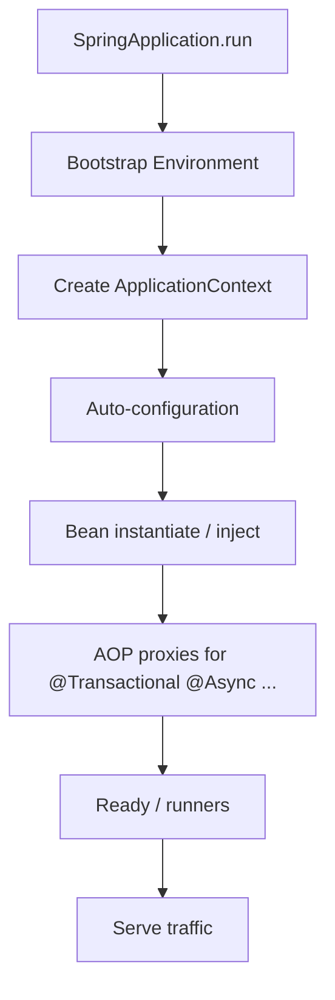

# 13 — Spring Boot for Senior / Lead Interviews

## Introduction

Most enterprise senior Java roles assume **Spring Boot** fluency: IoC, starters, web, data, transactions, security, and production observability. Interviews dig into **pitfalls** (proxies, transactions, circular deps) more than annotations trivia.

## Definition

**Spring Boot** is an opinionated framework for building production-ready Spring applications: auto-configuration, starter dependencies, embedded servers, Actuator, and externalized config — built on the Spring Framework IoC container and AOP proxies.

## Internal Working



### IoC / DI

- Constructor injection preferred
- Beans are typically singletons
- Proxies enable cross-cutting (transactions, security)

### Autoconfiguration

- `@SpringBootApplication` → component scan + autoconfig
- Conditions (`@ConditionalOnClass`, …) activate beans when classpath/config match

### Transactions

- `@Transactional` on public methods via proxy (self-invocation bypasses!)
- Propagation, isolation, rollback rules matter

## Why it exists

Spring Boot removes endless XML/config boilerplate so teams can focus on domain logic while keeping a consistent, production-oriented baseline (metrics, health, config).

## Advantages

- Fast to production with sane defaults
- Huge ecosystem (Security, Data, Cloud)
- Test slicing (`@WebMvcTest`, `@DataJpaTest`)
- Actuator + Micrometer observability hooks

## Disadvantages

- Magic (autoconfig) can obscure behavior
- Proxy pitfalls surprise mid-levels
- Over-reliance on annotations without boundaries
- Upgrade costs (`javax` → `jakarta`, Boot 2 → 3)

## Time Complexity

Framework overhead is usually dominated by I/O. Watch:

| Area | Cost risk |
|------|-----------|
| N+1 JPA queries | Latency blowups |
| Wide transactions | Lock duration |
| Oversized JSON payloads | CPU/alloc |
| Chatty microservice calls | Tail latency |

## Memory Considerations

- Large heap from entity graphs / Open Session In View
- Hibernate first-level cache within session
- Embedded Tomcat thread stacks (platform threads)
- Boot 3 + Java 21: consider virtual threads for blocking web (measure)

## Code Examples

### Constructor injection + interface

```java
@Service
public class OrderService {
    private final OrderRepository repo;
    private final PaymentClient payments;

    public OrderService(OrderRepository repo, PaymentClient payments) {
        this.repo = repo;
        this.payments = payments;
    }

    @Transactional
    public OrderId place(PlaceOrder cmd) {
        Order order = Order.create(cmd);
        repo.save(order);
        payments.authorize(order);
        return order.id();
    }
}
```

### Self-invocation trap

```java
@Service
public class UserService {
    @Transactional
    public void a() { this.b(); } // b()'s @Transactional ignored (same class)

    @Transactional(propagation = Propagation.REQUIRES_NEW)
    public void b() { ... }
}
```

Fix: split beans or inject self proxy carefully.

### RestController advice

```java
@RestControllerAdvice
public class ApiErrors {
    @ExceptionHandler(UserNotFoundException.class)
    @ResponseStatus(HttpStatus.NOT_FOUND)
    ProblemDetail handle(UserNotFoundException ex) {
        return ProblemDetail.forStatusAndDetail(HttpStatus.NOT_FOUND, ex.getMessage());
    }
}
```

### Actuator / metrics mindset

Expose health, readiness/liveness, Micrometer timers on critical paths; don’t open unprotected Actuator endpoints publicly.

## Common Interview Questions

**Q: @Component vs @Service vs @Repository?**  
**A:** Stereotype semantics; `@Repository` adds persistence exception translation. Functionally all components.

**Q: How does @Transactional work?**  
**A:** AOP proxy starts/commits/rolls back around method; self-call bypass; rollback on RuntimeException by default.

**Q: Bean scopes?**  
**A:** Singleton default; prototype; request/session (web); careful injection into singletons (proxy/`ObjectProvider`).

**Q: Spring Boot 3 major changes?**  
**A:** Jakarta EE namespace, Java 17 baseline, observability improvements, native/AOT options, security config DSL changes.

**Q: Open Session In View?**  
**A:** Keeps persistence context open for view rendering → hidden lazy loads; prefer disable + explicit fetch design.

**Q: How do you secure a REST API?**  
**A:** Spring Security filter chain; OAuth2/JWT resource server; CSRF for browsers; method security sparingly; least privilege.

## Senior Engineer Notes

- Prefer constructor injection; avoid field `@Autowired`.
- Design transactional boundaries around use-cases, not every repository call.
- Explicitly model fetch plans (join fetch / entity graphs).
- Externalize config; use profiles carefully; secrets not in git.
- Integration tests with Testcontainers for real DB/Kafka.

## Technical Lead Perspective

- Enforce module boundaries (API, domain, infra) — hexagonal / package by feature.
- Standardize Boot version, observability, error format (RFC 7807 Problem Details).
- Upgrade strategy for Boot 3 / Java 21 with compatibility matrix.
- Ban OSIV if it causes production N+1 surprises; educate the team.
- Production checklist: health probes, graceful shutdown, timeouts, retries with jitter, circuit breakers.

## Best Practices

1. Constructor injection + final fields.  
2. Thin controllers; rich domain/services.  
3. MapStruct/manual mappers at edges — keep entities out of API if needed.  
4. Timeouts on all remote calls (`RestClient`/`WebClient`).  
5. Idempotent consumers for messaging.  
6. Use `@ConfigurationProperties` over scattered `@Value`.  
7. Fail-fast on missing required config.

## Common Mistakes

| Mistake | Fix |
|---------|-----|
| Field injection | Constructor injection |
| Catching exceptions inside @Transactional then not rethrowing | Rollback won’t happen |
| Entity as DTO | Separate API models |
| Unbounded `@Async` executor | Define pool |
| Exposing `/actuator/*` | Secure + minimize |
| Circular dependencies | Redesign; don’t force with `@Lazy` forever |

## Summary

Spring Boot interviews reward engineers who understand **proxies, transactions, data access costs, security, and production operations** — not just annotation names.

## Cheat Sheet

| Topic | Key point |
|-------|-----------|
| DI | Constructor |
| @Transactional | Proxy; no self-invoke |
| JPA | Fetch plans; avoid N+1 |
| Security | Filter chain + JWT/OAuth2 |
| Config | ConfigurationProperties |
| Ops | Actuator + Micrometer |
| Boot 3 | Jakarta + Java 17+ |

## Exercises with Answers

**E1.** Why might `@Transactional` on a `private` method do nothing?  
**A1.** Proxies don’t intercept private/self invocations; method must be public on a Spring bean called externally.

**E2.** Design timeout + retry for a payment HTTP call.  
**A2.** Client timeouts; limited retries only on idempotent/safe ops; exponential backoff; circuit breaker; metrics.

**E3.** OSIV disabled; LazyInitializationException in API layer. Fix?  
**A3.** Fetch join / DTO query at repo; don’t lazy-load in serializers.

**E4.** Circular dependency A↔B. Resolve?  
**A4.** Extract C; event; rethink ownership — avoid `@Lazy` as permanent fix.
