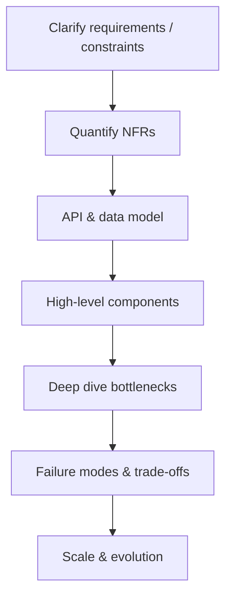

# 14 — System Design (Java-Centric)

## Introduction

Senior and lead loops include system design: APIs, data, consistency, scale, and failure. As a Java principal, ground designs in **what you’d actually build** on the JVM — Spring services, Kafka, Postgres, caches, and clear SLOs.

## Definition

**System design** is the craft of proposing a software architecture that meets functional requirements and non-functional goals (latency, availability, durability, cost, security) under realistic constraints and growth.

## Internal Working

### Interview flow



### Building blocks (typical Java stack)

| Component | Options |
|-----------|---------|
| API | Spring Boot REST/gRPC |
| Compute | Stateless services + VT/platform pools |
| Data | PostgreSQL / MySQL; Redis; Elasticsearch |
| Async | Kafka / SQS / RabbitMQ |
| Edge | API Gateway, CDN, WAF |
| Obs | OpenTelemetry, Micrometer, logs, traces |

### Consistency spectrum

```
Strong ←———→ Eventual
Single DB txn | Read replicas | Cache | Multi-region async
```

## Why it exists

Interviews simulate how you’d shape systems that survive growth and failure. Leads must sequence delivery and choose boring, operable tech when possible.

## Advantages (of structured design)

- Shared language for trade-offs
- Early discovery of bottlenecks
- Explicit failure planning
- Better alignment with SLOs

## Disadvantages / Risks

- Over-engineering for Day-1 scale
- Distributed monoliths (chatty microservices)
- Ignoring operational cost
- Premature Kafka-for-everything

## Time Complexity

Translate to capacity math:

| Estimate | How |
|----------|-----|
| QPS | Peak users × actions / period |
| Payload | Bytes × QPS = network/disk |
| Storage | Records × size × retention × growth |
| p99 latency | Budget across hop chain |

Show your work on the whiteboard.

## Memory Considerations

- JVM heap sizing vs cache hit rate  
- Redis memory = keys + structures + overhead  
- GC under large heaps for in-memory designs  
- Consumer buffer memory for Kafka  

## Code Examples

### Idempotent API sketch

```java
@PostMapping("/payments")
public ResponseEntity<PaymentView> pay(
        @RequestHeader("Idempotency-Key") String key,
        @RequestBody PaymentRequest req) {
    return paymentService.charge(key, req);
}
```

```sql
CREATE TABLE idempotency_keys (
  key TEXT PRIMARY KEY,
  response_hash TEXT NOT NULL,
  created_at TIMESTAMPTZ NOT NULL
);
```

### Outbox (reliable publish)

```text
DB Transaction:
  1) Update business row
  2) Insert outbox event
Async:
  Publisher relays outbox → Kafka
Consumer:
  Idempotent handler by eventId
```

## Common Interview Questions / Prompts

**Design URL shortener**  
Clarify: read/write ratio, custom aliases, expiry. API: POST create, GET redirect. Data: base62 IDs, cache hot keys, SQL/NoSQL. Scale: shard by hash; CDN optional.

**Design rate limiter**  
Token bucket / sliding window; Redis; per-user/IP keys; edge vs service; accuracy vs cost.

**Design notification system**  
Ingest API → Kafka → workers per channel; templates; retries; user prefs; idempotency.

**Design ticket booking**  
Inventory reservation with TTL; strong consistency on seats; payment saga; oversell prevention.

**Design news feed**  
Fan-out on write vs read; caching; ranking; celebrity problem.

For each: start with requirements, then numbers, then diagram, then deep dive.

## Senior Engineer Notes

- Prefer **simple monolith modularized** until scale/team boundaries demand services.
- Make every remote call timeout; every consumer idempotent.
- Choose consistency per use-case, not globally.
- Design for observability first-class (trace IDs end-to-end).
- Call out multi-tenant and security early if relevant.

## Technical Lead Perspective

- Sequence: MVP → correctness → scale hotspots → multi-region only if needed.
- Cost and team skill are first-class constraints.
- Write ADRs for irreversible choices (data model, message bus).
- Plan migrations (dual-write, backfill, cutover).
- Define SLOs before arguing for Kafka/microservices.

## Best Practices

1. Clarify read/write ratios and consistency needs.  
2. Draw trust boundaries and data ownership.  
3. Back-of-envelope before diving into tech logos.  
4. Explicit failure modes: retry, poison message, partial outage.  
5. Cache with TTL + invalidation story.  
6. Prefer at-least-once + idempotency over pretending exactly-once.  
7. Keep services coarse enough to own a domain.

## Common Mistakes

| Mistake | Better |
|---------|--------|
| Jumping to microservices | Modular monolith first |
| Ignoring idempotency | Keys + dedupe |
| Single DB god table forever | Evolve with measurements |
| Cache without invalidation | Define source of truth |
| No capacity numbers | Always estimate |
| Silent data loss on retries | Outbox / journaling |

## Summary

System design interviews reward **structured reasoning**: requirements → numbers → components → deep dives → failures → evolution — with Java/Spring realism.

## Cheat Sheet

| Concern | Pattern |
|---------|---------|
| Scale reads | Cache, replicas, CQRS selectively |
| Scale writes | Partition, queues, batching |
| Consistency | Transactions / sagas / idempotency |
| Fan-out | Async messaging |
| Hot keys | Replicate / coalesce / local cache |
| Deploy risk | Canary, feature flags |
| Exactly-once | Illusion → idempotent processing |

## Exercises with Answers

**E1.** 10M daily active users, 20 feed refreshes/day average. Est. read QPS?  
**A1.** 10e6 × 20 / 86400 ≈ 2300 avg QPS; design for peak (e.g., 5–10×) → ~10–20k QPS.

**E2.** Why outbox over “save then publish”?  
**A2.** Process crash between DB commit and publish loses events; outbox keeps them atomic with state.

**E3.** Pick store for session: Redis vs DB.  
**A3.** Redis for ephemeral low-latency sessions with TTL; DB if strong durability/audit needed.

**E4.** Payment webhook delivered twice. Design consumer.  
**A4.** Idempotency key / event id unique constraint; process once; same response thereafter.
